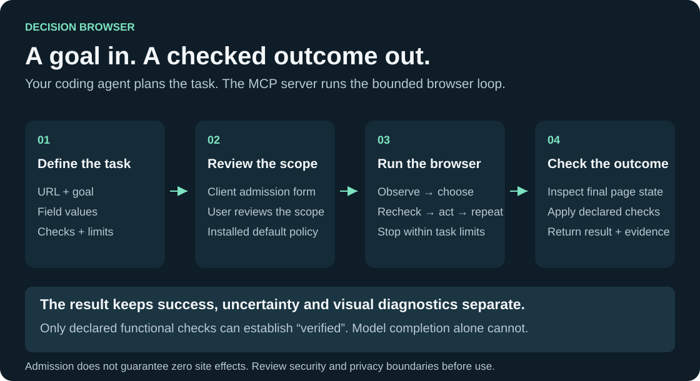
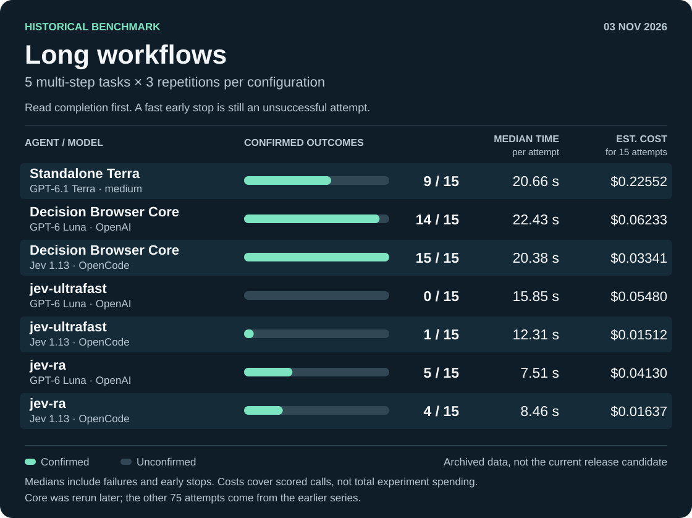
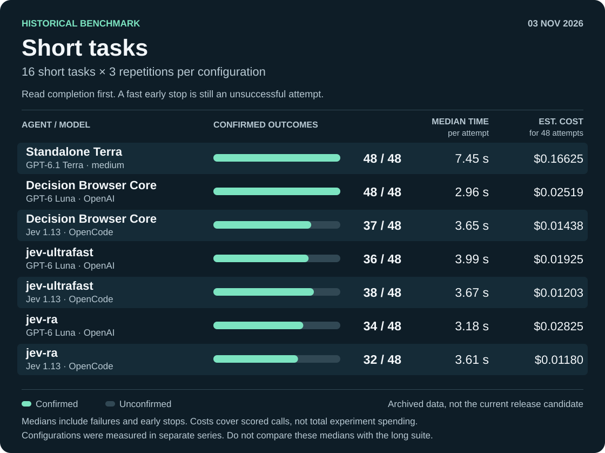

<h1 align="center">Decision Browser</h1>

<p align="center">
  <strong>Browser tasks for coding agents. Bounded execution. Checkable outcomes.</strong>
</p>

<p align="center">
  <a href="docs/public-release-checklist.md"></a>
  <a href="pyproject.toml"></a>
  <a href="src/decision_browser/server.py"></a>
  <a href="docs/installation.md"></a>
  <a href="LICENSE"></a>
</p>

<p align="center">
  <a href="#quick-start">Quick start</a> ·
  <a href="#how-it-works">How it works</a> ·
  <a href="#mcp-tools">MCP tools</a> ·
  <a href="#providers">Providers</a> ·
  <a href="#boundaries">Boundaries</a> ·
  <a href="#benchmarks">Benchmarks</a>
</p>

Decision Browser is a **stdio MCP server for Codex and Claude Code**. Give your
agent a URL, a goal and a final check. The server runs the browser task within
explicit limits, checks the resulting page and returns evidence the agent can inspect.

For example: choose **Zurich Airport (ZRH)** from a menu that also contains the
city and an airport hotel, then check the selected field value. The model chooses
among observed controls; the runner rechecks the target before acting.

| You supply | Decision Browser handles | You get back |
| --- | --- | --- |
| Goal, URL and field values | Observation and bounded action selection | Run status, reason and recovery guidance |
| Functional checks | Checks against the resulting page | Verified, failed or unverified outcome |
| Step, time, call and byte limits | Budget enforcement and cleanup | Usage counters, timings and evidence artifacts |

> **Experimental, version 0.1.1.**

## Quick start

### 1. Install and choose a provider

Open a terminal in your project with Node.js 20+ (including npm/npx) and your
client CLI on `PATH`, then run the pinned npm package.

```sh
npx --yes @haffa/decision-browser@0.1.1 setup codex
```

Use `setup claude` for Claude Code or `setup both` for both clients. Plain `setup`
prompts for the client. Next, select a provider and enter its API key through
hidden input for a hosted preset. The preset supplies the endpoint and model.
An existing local System One service is also available.

The launcher prepares uv and Python automatically. The coding client starts the
MCP server. Setup downloads the pinned runtime and Chromium. For unattended
installation, use `install codex` in place of `setup codex`.

Setup installs the MCP configuration, skill and sandboxed Chromium in the current
project. Installation checks do not use a model key or make API requests. Add
`--project "/path/to/project"` to choose another directory or `--upgrade` to update.
Existing settings are preserved; conflicts stop setup. Nothing changes global
client settings or grants project trust. Linux needs Playwright's host libraries
and a working Chromium sandbox. Downloads require network access.

On macOS/Linux, provider selection and its key are saved outside projects in
`~/.config/decision-browser/provider.json`, with private file permissions. This
is a local file, not encrypted storage. Windows key persistence is not supported
yet; environment configuration remains available. Cancelled key entry leaves
the installed runtime intact and shows a resume command.

[Python, standalone archive and source-checkout alternatives](docs/installation.md) ·
[Build a reviewed installer](docs/releasing.md)

### 2. Connect your coding client

The server reads your saved profile automatically. To change providers or run an
optional local diagnostic, use the same reviewed package:

```sh
npx --yes @haffa/decision-browser@0.1.1 configure
npx --yes @haffa/decision-browser@0.1.1 doctor --json
```

These commands reuse a cached package runtime and do not reinstall Chromium.
Existing
environment overrides remain supported and can take precedence over the profile;
see the [provider guide](docs/providers.md). Saving a key does not verify API access.

Restart the client in your project, review its trust and MCP approval prompts,
confirm `decision_browser` connects, and load the `decision-browser` skill.
Ask the agent to call `capabilities` before starting a task. The installer uses
`standard_form` admission: review the proposed scope in the client's native form
before browser work begins. Setup does not approve tools on your behalf.

### 3. Give the agent a task with a final check

On your own site, provide the URL, goal and exact outcome you want checked. For a
small local example, serve the included counter **from a development checkout**:

```sh
python3.12 -m http.server 8765 --bind 127.0.0.1 --directory examples/browser-control
```

Then ask your agent:

> Use Decision Browser in isolated mode to open
> http://127.0.0.1:8765/counter.html. Click inc three times and leave reset alone.
> Verify that #count has text 3. Allow four browser steps and four provider calls.

The opening navigation consumes one step. See the
[complete MCP task request](examples/browser-control-task.json). This example is
optional, not an installation prerequisite; a model-driven run may incur API charges.

**Installation readiness, provider access, native admission and task success are
separate checks.** A successful installer does not establish all four.

## Try it without a model key

From the development checkout, run two synthetic tasks with a real browser and
scripted decisions. They make no provider requests:

```sh
uv sync --frozen --group dev --python python3.12
.venv/bin/python -m playwright install chromium
report_dir=$(mktemp -d)
.venv/bin/python scripts/run_browser_scenarios.py \
  --cases hotel,autocomplete --output "$report_dir/scenarios.json"
```

These shell commands use POSIX paths and require the browser's host libraries and
sandbox support. Expected summary: `"status": "PASS", "passed": 2, "total": 2`.
The hotel task applies filters and opens Casa Flora; autocomplete selects the
airport among similar labels. `functional` records page checks, while `oracle`
compares expected and observed fixture events.

Use `--list` to see the corpus. Scripted fixture results are not live-model or
native-client acceptance. [Scenario guide](docs/browser-scenarios.md).

## How it works



The runner bounds browser steps, provider calls, input/output bytes, stored
artifacts and elapsed time. Model output selects from the offered action space;
it does not become arbitrary browser JavaScript. The agent supplies field values
and the checks that define success.

**A model saying “done” is not a verified result.** Only declared functional checks
can establish `functional: verified`. Empty checks do not verify a task, and visual
diagnostics are reported separately.

## MCP tools

| Tool | Arguments | What it does |
| --- | --- | --- |
| `capabilities` | None | Reports modes, actions, provider configuration and admission policy. |
| `start_task` | `request` | Starts one bounded task. Retain `result.run_id`; do not submit again to poll. |
| `get_task` | `run_id?` | Reads the run. `{}` recovers the single held run if the start reply was lost. |
| `present_admission` | `run_id`, `proposal_id`, `digest` | Asks the client to present the pending scope proposal. |
| `cancel_task` | `run_id` | Requests cancellation. Poll until cleanup finishes. |
| `read_artifact` | `run_id`, `artifact_id`; optional `channel`, `offset`, `limit` | Reads at most 65,536 bytes. Default `legacy` preserves the original small-artifact envelope; use `structured` or `resource` for paginated reads. |

Keep polling `queued`, `awaiting_human_admission` and `running`, including a
`running` result whose reason is `finalizing`. Present only the server's pending
proposal and let the user respond in the client; do not fabricate an approval.
Before its proposal exists, a standard-form task reports `queued` with reason
`preparing_admission`. `awaiting_human_admission` identifies an available proposal.
Domain errors retain their fixed `{"error": "code"}` envelope and set MCP
`isError: true`; successful task envelopes remain `result` plus `pending_proposal`.
Omitting `get_task.run_id` or supplying JSON null reads the current run; the literal
string `"null"` is a run ID and never selects the current run.

The default artifact `legacy` channel preserves the original four fields
(`id`, `media_type`, `content`, `sha256`) in both text JSON and structured output,
with base64 duplication bounded to a 65,536-byte artifact. Larger artifacts or
ranged legacy calls fail with `artifact_range_required` rather than silently
truncating a purported whole artifact. For pagination, explicitly request
`channel: "structured"` or `"resource"`, `offset` (default 0), and `limit`
(default and maximum 65,536 bytes). These range-v1 channels encode each chunk
once: in structured `content`, or in an embedded binary resource. Both retain the
artifact's full `sha256` and report `chunk_sha256`, `total_bytes`, `offset`,
`next_offset` and `eof`. Reassemble the chunks and verify the full hash. A resource
URI identifies this response's bytes; it does not authorize filesystem/network
access. The advertised `capabilities.artifact_read` describes the channel contract.

With no independent checks, `DONE` yields `completed_unverified`; `UNABLE` yields
`blocked` / `model_unable`, also functionally unverified. With checks, their
independent outcome remains decisive. Neither model stop word proves success.

One run occupies the server through retention: until the later of its original
deadline plus cleanup grace or 60 seconds after execution ends. Results are held
in memory, so restarting the server loses that state. Read artifacts through their
advertised IDs rather than treating them as filesystem paths.

[Request/result schema](src/decision_browser/contracts.py) ·
[Complete agent guide](skills/decision-browser/SKILL.md) ·
[Admission modes](docs/task-scoped-admission.md)

## Results and stopping conditions

Read `terminal`, `functional`, `reason` and `recovery` together:

| Terminal result | Meaning |
| --- | --- |
| `verified` | Declared functional checks passed. |
| `completed_unverified` | Execution ended without verified functional success. |
| `verification_failed` | A declared outcome check failed. |
| `blocked`, `refused`, `unsupported` | Policy, admission or capability prevented completion. Inspect the reason. |
| `limit_exceeded`, `cancelled`, `failed` | A budget, cancellation or error ended the task. |
| `outcome_unknown` | An action may have happened. Reconcile the evidence before retrying. |

Visual findings do not override functional results. Local geometry diagnostics
cover up to three viewport sizes, but the image-inspection path reports
`incomplete`; it is not a visual pass. See the
[visual task example](examples/visual-task.json).

## Providers

Select a route with **`decision-browser configure`**, or use the advanced MCP
environment settings below. Provider, model, endpoint and credential settings
are not MCP task arguments.

| `DECISION_BROWSER_PROVIDER` | Decision route | Credential |
| --- | --- | --- |
| `openai` (default) | OpenAI Decisions | `OPENAI_API_KEY` |
| `typesafe` / `jev` | TypeSafe System One | `TYPESAFE_API_KEY` |
| `openrouter` | OpenRouter Decisions | `OPENROUTER_API_KEY` |
| `opencode` | OpenCode Console System One (Jev) | `OPENCODE_API_KEY` |
| `gemini` | Gemini Decision 1 through OpenCode Console | `OPENCODE_API_KEY` |
| `local` / `nimble` | Loopback System One service | No key required by default |

For Gemini Decision 1, run `decision-browser configure gemini` and enter an
OpenCode Console API key. The preset selects `gemini-decision-1` automatically.

The selected route does not inherit another provider's key. Failed requests are
not automatically retried or rerouted. OpenCode Go is a separate subscription;
the Console route does not establish Go coverage. A local service must implement
System One, not just a chat-completions endpoint.

Supply known field text through `TaskRequest.values`. System One decision models
choose options rather than generate arbitrary text. Unbound text generation
requires the separately configured text helper; OpenAI uses its native Responses
helper. Helpers share the task's privacy gates, deadline and call/byte budgets.

For endpoint/model overrides, Ollama setup, choice limits, optional text helpers
and credential handling, see the [provider guide](docs/providers.md) and
[Codex configuration examples](examples/codex.providers.toml).

## CLI

Use the environment installed for your project. Its Python path is recorded in
the generated MCP settings.

| Command | Purpose |
| --- | --- |
| `decision-browser setup [codex\|claude\|both]` | Installs in the current project, then chooses and saves a provider interactively. |
| `decision-browser configure [provider]` | Chooses or changes the user-level provider profile. |
| `decision-browser serve` | Runs the stdio MCP server. |
| `decision-browser doctor --json` | Checks local prerequisites and configuration without an API call. |
| `decision-browser-install --client codex --project "/path/to/project"` | Runs the wheel's bundled project installer. Use `claude` or `both` as needed. |

The installer entry point includes its build inputs; `--source` is only an
optional developer override. Browser tasks are submitted through MCP, not a
`decision-browser run` shell command.

### Update or remove

Repeating an install prepares and probes a fresh runtime before switching managed
registrations. To use a reviewed new distribution, add `--upgrade` and include
**every previously installed client**:

```sh
python3.12 /path/to/decision-browser.pyz --client both --project "/path/to/project" --upgrade
python3.12 /path/to/decision-browser.pyz --client both --project "/path/to/project" --uninstall
```

Removal deletes unchanged managed entries and skills, preserving other settings.
Runtime/cache files remain for manual cleanup. Edited managed files stop the
operation instead of being overwritten. Close clients before changing their
registrations. [Conflicts and recovery](docs/installation.md).

## Boundaries

| Area | Current behavior |
| --- | --- |
| Actions | Navigation, click, fill, native select, Enter, submit, scroll, wait and screenshot. |
| Unsupported interactions | Frames, shadow DOM, canvas interaction, file transfers and opening additional tabs are outside the action set. |
| `isolated` session | Creates a fresh browser context. Prefer this for initial evaluation. |
| `existing_chrome` session | Uses one owned tab in a selected existing context and shares its cookies. Treat this as access to the logged-in account. |
| Consequential effects | Recognized purchase, send, publish, delete, transfer and booking actions are blocked. Ordinary controls can still autosave or cause other site effects. |
| Privacy | Page-derived data and supplied values may reach the configured provider. Image settings do not stop text transmission; redaction is not universal. |
| Installation | Local project setup for Codex and Claude Code. Cloud/Cowork installation is not provided; native Windows installation has not been exercised. |

Admission is **not an OS or network sandbox**, and page content is untrusted.
Use authorized sites and minimally privileged accounts. Chromium's sandbox stays
enabled; do not disable it to work around launch failures. Inspect screenshots
and artifacts before sharing them.

Native human admission and live provider access need separate verification in
each actual client. Local fixtures and mocked transport tests do not establish
that compatibility or production readiness.

[Security policy](SECURITY.md) · [Action classification](docs/action-classification.md)

## Benchmarks

### Browser tests: 17 November 2026

The baseline snapshot ran all 21 published cases three times on each route:
189 real browser attempts, including every failed attempt. Twenty cases use
synthetic fixtures; `public_about` follows Python.org's public About link.

| Agent and route | Confirmed | Physical API calls | Reported input tokens | Reported output tokens |
| --- | ---: | ---: | ---: | ---: |
| Decision Browser · TypeSafe Jev `jev-1.14.0` | 13/63 | 530 | 1,810,309 | 161,088 |
| Decision Browser · OpenAI Decisions `gpt-6-luna` | 52/63 | 293 | 738,574 + unknown | 0 + unknown |
| Standalone Terra · `gpt-6.1-terra`, medium | 57/63 | 384 | 390,682 | 9,744 |

One Decisions call returned HTTP 503 and its usage was not captured. Its token
consumption is unknown and excluded from the reported partial totals. No attempt was retried.
Jev used TypeSafe directly, with `jev-latest` resolving to `jev-1.14.0`.
Confirmation requires native completion, independent page and event checks,
cleanup, and complete reported input/output usage. All sessions were isolated;
Core used development `task_scope` admission.

[All case results, errors, token details and source snapshots](docs/benchmarks/2026-11-17-browser-matrix/report.md)
· [189 audited attempts (CSV)](docs/benchmarks/2026-11-17-browser-matrix/audited-runs.csv)
· [Audit and reporting correction](docs/benchmarks/2026-11-17-browser-matrix/audit.json).

#### Failure rerun

The updated snapshot reran each of the 67 unconfirmed attempts once with the
same goals and limits. The last column combines the retained baseline successes
with confirmations from the rerun.

| Agent and route | Baseline confirmed | Confirmed in rerun | Retained + recovered |
| --- | ---: | ---: | ---: |
| Decision Browser · TypeSafe Jev `jev-1.14.0` | 13/63 | 9/50 | 22/63 |
| Decision Browser · OpenAI Decisions `gpt-6-luna` | 52/63 | 7/11 | 59/63 |
| Standalone Terra · `gpt-6.1-terra`, medium | 57/63 | 6/6 | 63/63 |

[Per-case results, timings, token usage and remaining errors](docs/benchmarks/2026-11-17-browser-remediation/report.md)
· [Rerun attempt CSV](docs/benchmarks/2026-11-17-browser-remediation/audited-runs.csv).

#### OpenCode Console

Two fresh series ran all 21 cases with three repetitions per model on the
paid Console System One API. The direct TypeSafe series above used Jev 1.14.0,
while Console used Jev 1.13.

| Model | Confirmed | Median attempt | Input tokens | Output tokens |
| --- | ---: | ---: | ---: | ---: |
| Jev 1.13 | 58/63 | 4.12 s | 1,370,208 | 110,282 |
| Gemini Decision 1 | 63/63 | 5.04 s | 1,217,843 | 0 |

[Console results by case, token usage and failures](docs/benchmarks/2026-11-17-opencode-console-matrix/report.md)
· [All 126 attempts (CSV)](docs/benchmarks/2026-11-17-opencode-console-matrix/audited-runs.csv).

### Archived measurements

The static charts below keep every model visible at once. Longer workflows and
short tasks have separate figures and cost denominators. Completion comes first;
a fast early stop is not a successful task.

**These measurements predate this release candidate.** They use the former name
**Decision Browser Core** and retain their original revisions, models, failures,
budgets and scoring rules. Their source commits are not part of the new
clean-history repository. These are newly drawn charts of archived data, not new
measurements of this tree.

### Long workflows: 5 tasks, 3 repetitions



[Method, per-task outcomes and source revisions](docs/benchmarks/2026-11-03-long-suite/report.md).
Core's 30 attempts were rerun; the other 75 are from the earlier series. The
series ran at different times. The chart uses the latest recorded Core results.

### Short tasks: 16 tasks, 3 repetitions



| Source report | What it covers |
| --- | --- |
| [GPT-6 Luna libraries](docs/benchmarks/2026-11-03-decision-browser-article-cost.md) | Library comparison and the context-cost follow-up. |
| [Standalone Terra](docs/benchmarks/2026-11-03-terra-medium/report.md) | The separate Terra comparison and its scoring. |
| [Core with Jev](docs/benchmarks/2026-11-03-main-providers/report.md) | Decision Browser Core provider outcomes, timings and estimated costs. |
| [Other Jev libraries](docs/benchmarks/2026-11-03-browser-providers/report.md) | The jev-ra and jev-ultrafast provider comparison. |

Each configuration's median includes unsuccessful attempts and early stops.
Time includes process/browser startup and cleanup. Costs are estimates for scored
calls, not full experiment spending. The short-suite configurations come from
separate benchmark series. No result here guarantees general-site reliability.
The original [animated comparison](docs/assets/browser-four-agents.gif) remains
available as a historical artifact; the README does not autoplay it.

## FAQ

**Do I need a model key to install it?** The unattended `install` command needs
none. Interactive `setup` installs first, then asks for the chosen hosted
provider's key. Neither makes a provider request. Real model-driven tasks need
a configured provider; the scripted fixtures above do not.

**Can I use my signed-in Chrome?** `existing_chrome` is available under the
standard-form policy. It shares the selected context's cookies, so use a dedicated
test account and review the requested scope. See [admission modes](docs/task-scoped-admission.md).

**Does `doctor` prove that my provider works?** No. It checks local prerequisites
and configuration without contacting the API. Entitlement, native approval and a
verified browser task each require their own acceptance check.

**What if the task stops after a click?** Inspect the result and evidence. In
particular, `outcome_unknown` means the action may have happened; do not blindly
resubmit the task.

## Development

Use Python 3.11+, uv, Node.js and the pinned full Chromium with its host libraries.
CI covers Python 3.11–3.13. From the checkout, with prerequisites available, run:

```sh
python3.12 -I scripts/verify.py --profile full --output-dir ../verification-new
```

Choose a fresh output directory outside the repository. The verifier builds and
installs the exact wheel, checks dependencies, lint and types, then runs unit and
owned-browser tests. It makes no paid model requests. An offline unit pass is not
a full browser-suite pass.

[Contributing](CONTRIBUTING.md) · [Verification guide](docs/verification.md) ·
[Native client acceptance](tests/native/README.md) · [Live acceptance](tests/live/README.md)

## License and project links

Decision Browser is [MIT licensed](LICENSE). Distributed upstream excerpts retain
their [third-party notices](THIRD_PARTY_NOTICES.md). README layout inspiration:
[jev-ra](https://github.com/brnyxx/jev-ra); its prose and artwork are not reproduced here.

[Installation](docs/installation.md) · [Support](SUPPORT.md) ·
[Changelog](CHANGELOG.md) · [Release checklist](docs/public-release-checklist.md) ·
[Release procedure](docs/releasing.md)

The remaining work toward the one-command public release is tracked in the
[delivery plan](docs/public-release-plan.md).
