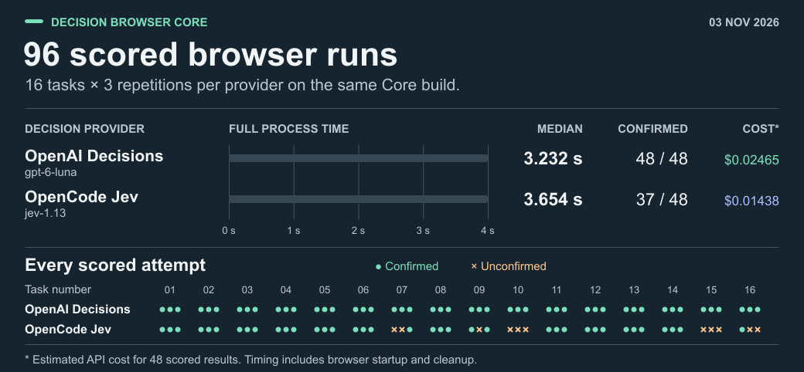

# Decision Browser Core on two decision providers

On 3 November 2026, Decision Browser Core at `e3f9942d630c` ran all 16 browser tasks three times with each provider. The completed series produced 96 scored results in 96 physical attempts.

| Decision route | Confirmed | Independent checks passed | Median process time | Decision HTTP requests | Text HTTP requests | Estimated scored API cost |
| --- | ---: | ---: | ---: | ---: | ---: | ---: |
| OpenAI Decisions · `gpt-6-luna` | 48/48 | 48/48 | 3.232 s | 123 | 0 | $0.02465 |
| OpenCode Jev · `jev-1.13` | 37/48 | 37/48 | 3.654 s | 131 | 0 | $0.01438 |

Of 48 matched task/repetition pairs, both providers confirmed 37, OpenAI alone confirmed 11, Jev alone confirmed 0, and neither confirmed 0.

## Task results

Columns in the GIF follow this order. Each table cell counts confirmed repetitions out of three.

| Column | Task | OpenAI | Jev |
| ---: | --- | ---: | ---: |
| 01 | `click` | 3/3 | 3/3 |
| 02 | `search` | 3/3 | 3/3 |
| 03 | `select` | 3/3 | 3/3 |
| 04 | `navigate` | 3/3 | 3/3 |
| 05 | `counter` | 3/3 | 3/3 |
| 06 | `public_about` | 3/3 | 3/3 |
| 07 | `hotel` | 3/3 | 1/3 |
| 08 | `profile_form` | 3/3 | 3/3 |
| 09 | `autocomplete` | 3/3 | 2/3 |
| 10 | `calendar` | 3/3 | 0/3 |
| 11 | `styled_filter` | 3/3 | 3/3 |
| 12 | `consent` | 3/3 | 3/3 |
| 13 | `delayed_menu` | 3/3 | 3/3 |
| 14 | `loading_overlay` | 3/3 | 3/3 |
| 15 | `below_fold` | 3/3 | 0/3 |
| 16 | `article` | 3/3 | 1/3 |

### Unconfirmed results

| Provider | Task · repeat | Native result | Independent page checks | Fixture events or public URL |
| --- | --- | --- | --- | --- |
| OpenCode Jev | `hotel` · 1 | `failed` | Failed | Failed |
| OpenCode Jev | `hotel` · 2 | `failed` | Failed | Failed |
| OpenCode Jev | `autocomplete` · 2 | `failed` | Failed | Failed |
| OpenCode Jev | `calendar` · 1 | `verification_failed` | Failed | Failed |
| OpenCode Jev | `calendar` · 2 | `failed` | Failed | Failed |
| OpenCode Jev | `calendar` · 3 | `failed` | Failed | Failed |
| OpenCode Jev | `below_fold` · 1 | `failed` | Failed | Failed |
| OpenCode Jev | `below_fold` · 2 | `failed` | Failed | Failed |
| OpenCode Jev | `below_fold` · 3 | `failed` | Failed | Failed |
| OpenCode Jev | `article` · 2 | `verified` | Passed | Failed |
| OpenCode Jev | `article` · 3 | `verified` | Passed | Failed |

## Measurement

- Both arms used the same Core sources, goal, supplied values, page assertions, fixture event checks and 1280 × 720 browser viewport. Fifteen tasks used synthetic local pages. The public task followed the Python.org About link and checked the destination URL.
- Each run needed both native success and independent checks to count as confirmed. Time ran from child process launch to exit, including browser startup, API calls, checks and cleanup. The median uses all 48 scored durations per provider, including failed outcomes.
- Each task had up to 12 physical API requests, 128 KiB of request input, and 75 seconds. The six baseline tasks allowed eight steps, and the ten expanded tasks allowed 24. Provider order alternated across the task and repetition schedule.
- OpenAI decisions used the GPT-6 Luna Decisions endpoint. Jev decisions used OpenCode Console’s paid Jev 1.13 System One endpoint. Decision and helper requests are counted separately. The source digest and worker hash are included in the summary.

## HTTP accounting

An earlier series was interrupted by a host restart. Its last observed checkpoint contained 23 completed cells and 58 HTTP 200 responses. The per-attempt files were lost. All 96 cells were run again in the completed series. The earlier observations are excluded from the scores, timings and cost estimates, and their final billed cost is unknown.

All 96 first attempts were scored. No HTTP 503 retry was needed.

- **OpenAI Decisions** had 123 HTTP 2xx responses across its 123 scored requests, plus 0 requests in excluded attempts. Usage supports pricing 48 of 48 scored attempts.
- **OpenCode Jev** had 131 HTTP 2xx responses across its 131 scored requests, plus 0 requests in excluded attempts. Usage supports pricing 48 of 48 scored attempts.

Estimates apply standard USD rates per million reported tokens. OpenAI prices uncached input at $0.10, cache hits at $0.01 and cache writes at $0.125. Decisions output is free and Responses output costs $0.50. Jev input costs $0.042 and output is free. These estimates exclude browser operation, account-specific adjustments and access checks. [OpenAI Decisions pricing](https://developers.openai.com/api/docs/guides/decisions#pricing-and-availability) · [GPT-6 Luna pricing](https://developers.openai.com/api/docs/models/gpt-6-luna) · [OpenCode pricing](https://opencode.ai/v2/docs/console/models/#pricing)

Three repeats per task characterize this frozen Core build and workload. Durations include network and service variability.

[All 96 scored results (CSV)](runs.csv) · [Aggregate results and source identities (JSON)](summary.json)
