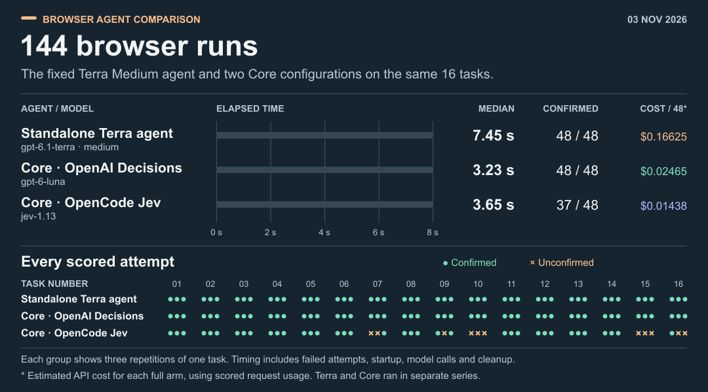

# Standalone Terra Medium on the browser task suite

Maintenance note: the checked-in `agent.py` now includes later offline-tested budget and
cleanup fixes. Historical result files and their recorded source hashes remain unchanged;
those hashes identify the agent at the publication revision, not the current file.
Run the current agent from a source checkout: it reuses
`scripts/benchmarks/long_protocol.py` for pricing. It remains independent of Core
and the external agent frameworks, but copying `agent.py` alone is not supported.
New long-suite records retain separate worker, agent, and pricing helper hashes.

Three browser-agent configurations each ran the same 16 tasks three times. The standalone agent used GPT-6.1 Terra at medium reasoning through the Responses API. The two Core series used GPT-6 Luna on OpenAI Decisions and Jev 1.13 through OpenCode. The chart combines 48 fresh observations from the fixed Terra agent with 96 previously published Core observations.



| Agent | Confirmed | Independent checks passed | Median process time | API requests | Estimated API cost for 48 scored attempts |
| --- | ---: | ---: | ---: | ---: | ---: |
| Standalone Terra agent · `gpt-6.1-terra · medium` | 48/48 | 48/48 | 7.4475 s | 171 | $0.16625 |
| Core · OpenAI Decisions · `gpt-6-luna` | 48/48 | 48/48 | 3.232 s | 123 | $0.02465 |
| Core · OpenCode Jev · `jev-1.13` | 37/48 | 37/48 | 3.654 s | 131 | $0.01438 |

Each median includes all 48 process durations in that arm, including failed trials. The clock measures startup, model calls, browser work, independent verification and cleanup.

The fixed agent explicitly completed 48/48 attempts and passed the independent browser checks on 48/48. It completed all three hotel attempts in six calls each. Each attempt had the same 12-call limit.

## Outcomes by task

| GIF column | Task | Standalone Terra | Core · OpenAI | Core · Jev |
| ---: | --- | ---: | ---: | ---: |
| 01 | `click` | 3/3 | 3/3 | 3/3 |
| 02 | `search` | 3/3 | 3/3 | 3/3 |
| 03 | `select` | 3/3 | 3/3 | 3/3 |
| 04 | `navigate` | 3/3 | 3/3 | 3/3 |
| 05 | `counter` | 3/3 | 3/3 | 3/3 |
| 06 | `public_about` | 3/3 | 3/3 | 3/3 |
| 07 | `hotel` | 3/3 | 3/3 | 1/3 |
| 08 | `profile_form` | 3/3 | 3/3 | 3/3 |
| 09 | `autocomplete` | 3/3 | 3/3 | 2/3 |
| 10 | `calendar` | 3/3 | 3/3 | 0/3 |
| 11 | `styled_filter` | 3/3 | 3/3 | 3/3 |
| 12 | `consent` | 3/3 | 3/3 | 3/3 |
| 13 | `delayed_menu` | 3/3 | 3/3 | 3/3 |
| 14 | `loading_overlay` | 3/3 | 3/3 | 3/3 |
| 15 | `below_fold` | 3/3 | 3/3 | 0/3 |
| 16 | `article` | 3/3 | 3/3 | 1/3 |

For each Terra/baseline pair, “both” means that the two agents independently confirmed the same task in the same repetition.

| Baseline | Both confirmed | Terra only | Baseline only | Neither |
| --- | ---: | ---: | ---: | ---: |
| Core · OpenAI Decisions | 48 | 0 | 0 | 0 |
| Core · OpenCode Jev | 37 | 11 | 0 | 0 |

## How the agents differ

- Terra received the goal, supplied values, its action history and a fresh Playwright accessibility snapshot. Its browser tool loop runs directly on Playwright without importing Core, jev-ra or jev-ultrafast. It selected one browser tool per response to click, fill, press a key, select, scroll, wait, navigate, finish or declare that it could not complete the task. Each action already supplied the next snapshot. The fixed agent had no separate snapshot tool and was instructed to call `done` when the page showed the goal. A `done` action indicated native success. It used a fresh 1280 × 720 Chromium context per attempt. The benchmark checked the requested `gpt-6.1-terra` model and `reasoning.effort=medium` on each request and validated the model ID reported in successful responses. [Model and API documentation](https://developers.openai.com/api/docs/models/gpt-6.1-terra)
- The Core agent used DOM observations, constrained action choices, native dispatch guards and its own stopping conditions. Both Core arms came from the earlier run. The three configurations differ in browser tools, model representation and stopping behavior. Their timings also reflect service and network variability between series. [Core baseline protocol and results](../2026-11-03-main-providers/report.md)
- All arms used the same task goals, supplied values, final page checks and fixture event sequences. Fifteen tasks used synthetic local pages. The Python.org task verified the public About URL. Confirmation required the agent’s own completion signal together with independent page and fixture checks. An unconfirmed browser run alone cannot pinpoint a model error.
- The standalone tasks used 75 seconds, up to 12 model calls, and a 128 KiB cumulative request budget. The six baseline cases allowed eight steps and the ten expanded cases 24, counting initial navigation. Terra saw the current URL, accessibility references and scroll state. Page checks, event oracles and fixture plans stayed outside the model input.
- [Fixed agent used for all 48 reruns](agent.py) · [Shared task definitions and scoring](../../../scripts/compare_browser_libraries.py). Each worker invocation accepts one JSON task on stdin, launches a fresh browser and returns one result with independent checks, selected actions and request usage. The published source SHA-256 matches every Terra attempt. The harness supplies the provider credential in the process environment.

## Hotel follow-up

Before the fix, Terra opened Casa Flora in all three attempts but spent its seven remaining calls requesting the same snapshot. The fixture recorded the correct visit in each attempt. Without a `done` action, all three hotel attempts remained unconfirmed. The original full run finished 45/48 with an 8.620 s median and $0.25177 in estimated API cost. Original report (historical revision `3a6548e72c116a5ceda6eefecc857f7c1cf445d1`) · Original 48 Terra observations and 96 Core observations (historical revision `3a6548e72c116a5ceda6eefecc857f7c1cf445d1`) · Original agent (historical revision `3a6548e72c116a5ceda6eefecc857f7c1cf445d1`)

Replaying the original action sequence in Chromium showed the following text on the first observation after opening the property. Two more reads returned the same text.

```text
- paragraph [ref=f1e2]: Casa Flora | Lisbon | Design | Free cancellation
```

A separate three-run hotel check tested the fix before this full rerun. In all three, Terra opened Casa Flora on call five and issued `done` on call six. All 18 HTTP requests succeeded. The chart and tables use the 48 Terra attempts from the full rerun. [Captured hotel observations and actions](hotel-rerun.json)

## Requests, retries and estimated costs

All 171 Terra API requests across the 48 scored attempts returned HTTP 200. No retries were needed. The earlier Core series excluded a preliminary run interrupted by a host restart, with unknown total billing. The published CSV records scored cost only.

Terra pricing was available for 48/48 scored attempts. We estimate standard API charges from reported tokens at $1.00 per million uncached input tokens, $0.05 for cache reads, $1.25 for standard 30-minute cache writes, and $5.00 for output. Reasoning tokens are included in output. An arm with incomplete token usage has no complete estimate. The Core figures use the per-attempt estimates from the earlier publication. Browser runtime, access probes and account-specific billing adjustments are outside the estimates. [Terra pricing](https://developers.openai.com/api/docs/models/gpt-6.1-terra) · [Core pricing methodology](../2026-11-03-main-providers/report.md)

[All 144 scored observations](runs.csv) · [Source hashes and aggregate results](summary.json)
